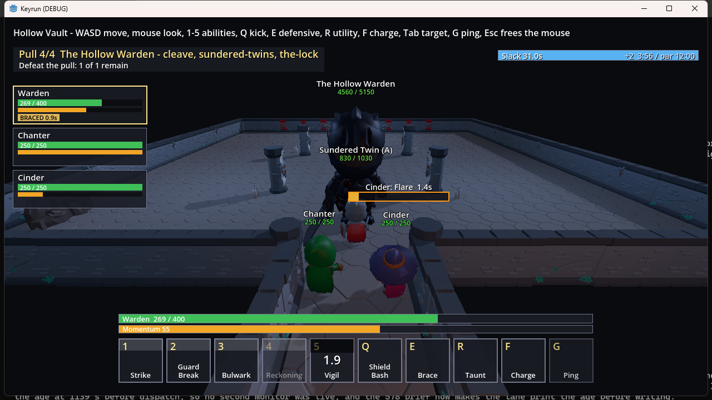

# Keyrun

Keyrun is a co-op dungeon game for Windows desktop: the Mythic+ loop from World of Warcraft with the world taken
away. You open one screen, pick a key, press Queue, run a timed dungeon with one boss, choose one of three rewards,
and land back on the screen. There are no quests, no shop and no open world ([design/BIBLE.md](design/BIBLE.md),
section 1). It is a proof of concept, built in Godot
4.7.2 .NET with C#.

Keyrun is built by [Aesop](https://github.com/matt82198/aesop) (npm `@matt82198/aesop`). Nobody on the project, the
person directing it or the model doing the work, had made a game before. The rules in the design bible came from
reading (the eleven briefs in [research/](research/)), the code came from Aesop's loop, and every decision, with who
made it and why, is on record in [STATE.md](STATE.md).

## The game

**Three tests.** Every design decision has to pass all three ([design/BIBLE.md](design/BIBLE.md), section 0):
depth and difficulty (real decisions on five buttons, keys hard because of what enemies do, not how much health
they have); a high key inside a minute; and strangers chill by default (no shareable score, no run ruined by one
mistake, backfill instead of abandonment, pings instead of typing).

**Ten keys.** Five rotational abilities, then interrupt (Q), defensive (E), class utility (R), movement (F) and ping
(G). WASD and mouse-look are the body and do not count (section 2).

**Combat.** Cast bars are the enemy's language: every dangerous enemy action is a cast with a visible bar and a
floor telegraph, read by shape plus colour, never colour alone. The sim is integer math at 20 Hz, and an interrupt
resolves by its intended tick, never by arrival order (section 3).

**Synergy.** Synergy is a timing game between two people. A Setup ability opens a three-second Window on a target;
a different class's Payoff landing inside it fires a named Combo (Shatter, Steam, Anthem and three more). Three
starter classes: the Warden (anchor), the Cinder (detonator) and the Chanter (conductor) (sections 4 and 5).

**The dungeon.** The Hollow Vault holds three teaching pulls and a boss (section 9):

- The Choir: a caster whose four-second heal must be kicked.
- The Pair: spread when marked, then stack when called. You learn to read shapes.
- The Seed: an elite that teaches the boss's core rule with nothing at stake.
- The Hollow Warden: Cleave, the Sundered Twins, and the Lock, a Window on the boss that only a Combo closes.

Inside the dungeon, WoW Mythic+ is the reference: a timer with par, an enemy-forces bar, optional packs and a patrol,
and a time cost for each death.

**Gear.** Five slots (Weapon, Armor, Charm, Ring, Keystone), with tier capped at 10. Every run ends with a choice of
one of three, and on a clear at least one of the three is an upgrade. Ash is banked every run and buys only
cosmetics and titles (section 7).



## Where it stands (2026-10-22)

- Built: the full loop from screen to queue, dungeon, choice of three and back. You play the Warden with a Chanter
  and a Cinder bot party. Bots and enemies path with integer A* inside the sim, each ability plays its own animation
  clip, and the boss fight is tuned to run 90 to 180 seconds at key 2.
- Planned: branching rooms and seeded dungeons (decisions D45 and D46; the route is one path today) and a wider pack
  roster. The plans are in open PRs.
- The milestone is a run Matt plays end to end and judges by feel (D10). Open work: [STATE.md](STATE.md), [BACKLOG.md](BACKLOG.md).

## What Keyrun gave back to Aesop

Each gap the game exposed in Aesop became a written rule or a gate there:

- **Purpose pin** ([LANE-CONTRACT.md](https://github.com/matt82198/aesop/blob/main/LANE-CONTRACT.md) 9b): every
  build dispatch says what the artifact is for, after five feature lanes went to the throwaway browser client as if
  it were the game.
- **A CI contract for game lanes** (LANE-CONTRACT "CI contract (keyrun)"; aesop PRs #1247 to #1259): job times,
  scene-test budgets, hook-safe shell shapes, push form, worktree collisions and stub-first reds, each from a Keyrun
  lane hand-back.
- **Row files for shared logs** (LANE-CONTRACT 8c): five Keyrun PRs went DIRTY because each one appended to the same
  build log. Lanes now write a two-line row file, and a fold lane merges the rows.
- **Push early** (LANE-CONTRACT 8d): an integration branch reached 154 commits over 15 hours with no push. A lane
  now pushes and opens a draft PR within 20 minutes of its first commit.
- **Lanes never launch the game**: parallel lanes launched Godot again and again until the machine froze. Only the
  orchestrator launches it, one instance at a time.
- **The product comes first**: machinery work is refused while the game has due findings and too few lanes, and the
  orchestrator may not sit idle with a thin fleet while open work exists.
- **Briefs built from disk**: each dispatch carries the current main sha and the locked rulings, read from the
  repo, so a lane does not start from a stale premise.
- **Crash recovery with no lost work**: STATE.md and BUILDLOG.md checkpoints with the reason at every safe boundary
  ([docs/CHECKPOINTING.md](https://github.com/matt82198/aesop/blob/main/docs/CHECKPOINTING.md)), one worktree per
  lane so a killed session leaves branches, not loss, and a compaction step that rehydrates intent and open findings
  from disk. Keyrun forced this by losing intent across context resets (the pinned INTENT block in STATE.md).
- **Building ahead of the human's gates**: inside stated bounds the orchestrator decides and reports, with four hard
  stops (deploys, spending, deletes, external messages). This came from Keyrun work stalling while it waited on
  Matt. Work that needs his call lands as an unarmed PR (for example #546, the Mythic+ dungeon plan, and #552, the
  seeded dungeon architecture), and the fleet keeps moving on everything else.

Aesop is a small package, and each domain it runs in pushes it toward determinism there: judgment calls that went
wrong once become gates and receipts.

## Build, run, test

Requires Godot 4.7.2 .NET and the .NET 8 SDK. A fresh checkout or worktree needs one setup pass, which builds the
solution and imports the assets:

```
powershell -NoProfile -ExecutionPolicy Bypass -File tools/godot/setup-worktree.ps1
dotnet build game/Keyrun.sln
tools/godot/godot.ps1 --path game
tools/godot/godot.ps1 --path game '--' --autorun --ticks 7000 --key 2 --seed 1
```

The third line plays the game. The fourth plays a scripted run with the bot party; add `--camera vertical` for the
top-down view (V toggles it in play). `--record-input PATH` and `--replay-input PATH` record a run and replay it at
the same seed and key ([game/fixtures/input/](game/fixtures/input/)).

Tests: `dotnet test game/Keyrun.sln` (sim, content, bots and playtest suites; CI job `game-test`), the per-step lane check
`tools/fastcheck.ps1`, and `npx vitest run tests/lanes` (the row-file gate). Scene tests and the exported build run
in CI as `game-e2e`.

## Read further

[design/BIBLE.md](design/BIBLE.md) (what the game is), [research/](research/) (the briefs it came from),
[STATE.md](STATE.md) (decisions and rulings), [BUILDLOG.md](BUILDLOG.md) (the build diary), [CLAUDE.md](CLAUDE.md)
(the domain map) and [game/CLAUDE.md](game/CLAUDE.md) (the engine, with one row per lane).

## Licence

MIT. See [LICENSE](LICENSE). Art credits are in [game/assets/ATTRIBUTION.md](game/assets/ATTRIBUTION.md).

🐢 Generated with Aesop
