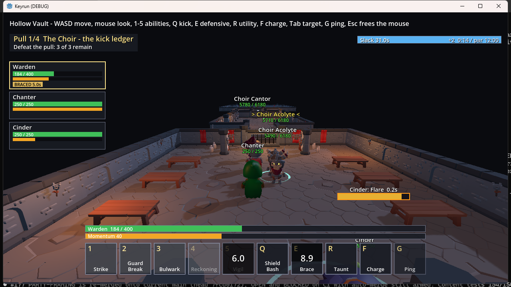
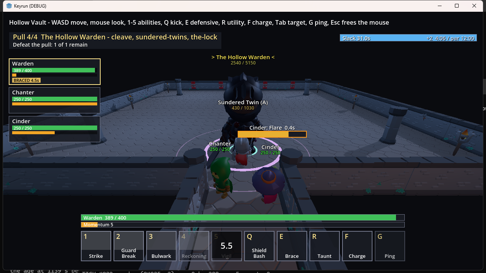
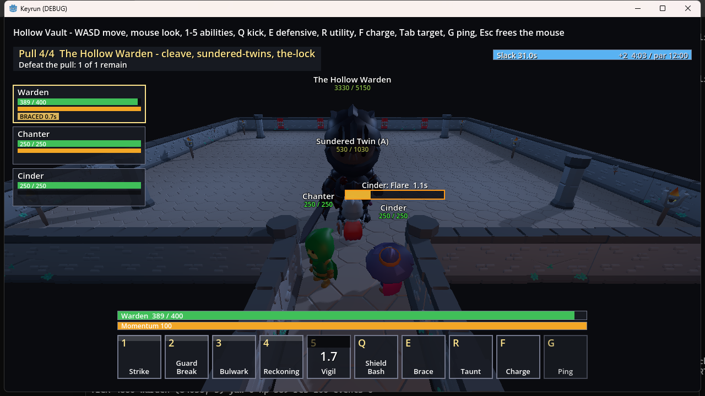

# Keyrun

Keyrun is a proof-of-concept co-op dungeon game for Windows desktop, built in Godot 4.7.2 .NET with C#. Its loop is
"Screen -> Queue -> Dungeon (timed, one boss) -> End-of-run choice of three -> Screen" ([design/BIBLE.md](design/BIBLE.md), section 1).
Each class is limited to five rotational abilities and ten keybinds in total ([design/BIBLE.md](design/BIBLE.md), section 2).

Keyrun is also Aesop's live demo. [Aesop](https://github.com/matt82198/aesop) is a multi-agent orchestration kernel for
autonomous software development. Aesop's lanes built this game end to end, for a person who does not make games. The
build diary runs from 2026-09-18 ([BUILDLOG.md](BUILDLOG.md), first entry) to 2026-10-19. Every decision, research brief,
plan, lane and contract that produced the game is linked below.

## Status

Proof of concept, in the engine rebuild.

- The game is a 3D run in the Hollow Vault: one class (the Warden) with a bot party, three pulls and a boss ([design/BIBLE.md](design/BIBLE.md), section 9).
- D10 (MVP = 3D gameplay) is open until Matt plays one complete run end to end. No human-played run is recorded yet ([STATE.md](STATE.md), D10).
- Open items, named in the pinned INTENT block: KF1 (combat animation reads badly), KF2 (bots idle in the first room), KF3 (the Seed elite spawns on entry and the bots cheese it), and the untelegraphed boss and Twins slams ([STATE.md](STATE.md), lines 3-24).

## What Aesop did here

1. **Research (2026-09-18).** Eleven cited briefs, each ending in a verdict. Format: [research/CLAUDE.md](research/CLAUDE.md).
   - [01 - What makes WoW Mythic+ fun, and what do its players hate?](research/01-mythic-plus-anatomy.md)
   - [02 - What do other co-op dungeon/instance games do better than WoW's Mythic+?](research/02-other-dungeon-runners.md)
   - [03 - Ability & Class Design](research/03-ability-and-class-design.md)
   - [04 - Talent Trees](research/04-talent-trees.md)
   - [05 - Gear Progression](research/05-gear-progression.md)
   - [06 - Encounter and Boss Design](research/06-encounter-and-boss-design.md)
   - [07 - How should the sim and netcode be built for a 5-player co-op ability game?](research/07-sim-and-netcode.md)
   - [08 - Character & Queue Screen](research/08-character-and-queue-screen.md)
   - [09 - Fellowship precedent](research/09-fellowship-precedent.md)
   - [10 - Is the genre cooked?](research/10-market-is-the-genre-cooked.md)
   - [11 - 20 Hz vs 30 Hz on the real playable: measuring D9](research/11-tick-rate-measurement.md) (raw results: [tick-rate-results.json](research/tick-rate-results.json) and [tick-rate-results-real-worker.json](research/tick-rate-results-real-worker.json))
2. **The design bible (2026-09-18).** [design/BIBLE.md](design/BIBLE.md) was written from the eleven briefs and Matt's decisions D1 to D9. Section 0 holds the three tests every decision must pass.
3. **The engine plan.** [design/ENGINE-PLAN.md](design/ENGINE-PLAN.md) first targeted a TypeScript browser first paint. D12 moved the game to Godot 4.7.2 .NET with C# ([STATE.md](STATE.md), D12). The TypeScript tree was removed in PR #553. The oracle fixtures recorded from it stay in `game/sim/Keyrun.Sim.Tests/Fixtures/oracle/` ([game/sim/ORACLE.md](game/sim/ORACLE.md)).
4. **The art plan.** [design/ART-PLAN.md](design/ART-PLAN.md) section 8 lays out the "Look and route" phase as a ladder of ten lanes. The ladder is recorded complete in [STATE.md](STATE.md) (STATE-R9 checkpoint). Art is CC0 packs only (D17, [game/assets/ATTRIBUTION.md](game/assets/ATTRIBUTION.md)).
5. **The decision log.** [STATE.md](STATE.md) holds D1 to D26 with the wording and provenance of each decision. The pinned INTENT block at its top (lines 3-24) is re-read before every lane is judged; it landed with [PR #183](https://github.com/matt82198/keyrun/pull/183).
6. **The lane ledger.** [game/CLAUDE.md](game/CLAUDE.md) has one row per lane: what the lane shipped and its PR number.
7. **The build diary.** [BUILDLOG.md](BUILDLOG.md) is append-only. Each entry gives WHY and WHAT for one lane or checkpoint.
8. **The contract.** Every lane ran under [LANE-CONTRACT.md](https://github.com/matt82198/aesop/blob/main/LANE-CONTRACT.md) in the Aesop repo.
9. **The proof discipline.** D15 says visible work is judged from frames and video before its row closes ([STATE.md](STATE.md), D15). The frames below are from the runs, and each was viewed before it was added.








## The game today

- **Keybinds.** WASD and mouse-look are the body and are not keybinds. The ten keybinds are 1 to 5 (rotation), Q (interrupt), E (defensive), R (class utility), F (movement) and G (ping) ([design/BIBLE.md](design/BIBLE.md), section 2).
- **Classes.** Three starter classes: the Warden (the anchor), the Cinder (the detonator) and the Chanter (the conductor) ([design/BIBLE.md](design/BIBLE.md), section 5).
- **Dungeon.** The Hollow Vault has three pulls and a boss. The Choir teaches the kick ledger, the Pair teaches reading shape, and the Seed teaches the boss's core rule with no stakes. The boss is the Hollow Warden: Cleave, The Sundered Twins and The Lock ([design/BIBLE.md](design/BIBLE.md), section 9; [content/data/dungeons/hollow-vault.json](content/data/dungeons/hollow-vault.json)). The HUD counts the boss as pull 4 of 4.
- **Four pulls.** The four pulls are the three pulls and the boss, shown as pull 1/4 to 4/4 in the HUD (see the frames above).
- **The Lock.** Shown as a view-only ring on the Hollow Warden ([STATE.md](STATE.md), D26; [game/CLAUDE.md](game/CLAUDE.md), LOCK-VIEW row).
- **Bots and backfill.** The bot party is in [game/bots/](game/bots/). Backfill and the queue are in the 3G and 3J rows of [game/CLAUDE.md](game/CLAUDE.md).
- **Art.** CC0 asset packs only, listed in [game/assets/ATTRIBUTION.md](game/assets/ATTRIBUTION.md) (D17).
- **Shipped lanes.** Each lane and its PR is in [game/CLAUDE.md](game/CLAUDE.md).

## Run (desktop build)

The real game is the Godot 4.7.2 .NET desktop build in `game/` (C#, decision D12 in [STATE.md](STATE.md)). Requires
Godot 4.7.2 .NET and the .NET 8 SDK (8.0.x).

```
dotnet build game/Keyrun.sln
dotnet test game/Keyrun.sln
tools/godot/godot.ps1 --headless --path game --build-solutions --quit
tools/godot/godot.ps1 --headless --path game --export-release "Windows Desktop" ../build/keyrun.exe
```

**Fresh checkout or worktree.** A new checkout or worktree fails its first Godot/C# build until the solution build has run once there. Before that run, make `dotnet` resolvable: put the .NET 8 SDK folder on `PATH`, or set `DOTNET_ROOT` to it (`tools/godot/godot.ps1` falls back to `%USERPROFILE%\.dotnet` when `DOTNET_ROOT` is unset). Then run this once:

```
tools/godot/godot.ps1 --headless --path game --build-solutions --quit
```

The export lands at `build/keyrun.exe` (the `build/` folder is gitignored). The Godot binary path is resolved by
`tools/godot/godot.ps1`, or set `KEYRUN_GODOT`. The engine plan and phase status are in
[design/ENGINE-PLAN.md](design/ENGINE-PLAN.md); the build's domain notes are in [game/CLAUDE.md](game/CLAUDE.md).

## Record and replay a run

A run's keys and camera yaw can be recorded from an interactive launch and replayed later at the same seed and key. The log is `keyrun.input-log/2`; camera pitch is not recorded. Build first:

```
powershell -NoProfile -ExecutionPolicy Bypass -File tools/godot/godot.ps1 --headless --path game --build-solutions --quit
```

Play a run and record it (the log is written at each run end and at quit):

```
powershell -NoProfile -ExecutionPolicy Bypass -File tools/godot/godot.ps1 --path game '--' --record-input game/fixtures/input/my-run.input-log.json --log build/my-run.txt
```

Replay the same log with `--replay-input` in place of `--record-input`, on the same path. A replay at a different seed or key is refused. Both flags are interactive only and are ignored under `--autorun`. Example logs are in [game/fixtures/input/](game/fixtures/input/).

## Test

Game tests (C#):

```
dotnet test game/Keyrun.sln
```

Per-step lane check (incremental build of `game/Keyrun.sln`, then only the test projects the diff can affect; the full
solution still runs in CI as `game-test`):

```
powershell -NoProfile -ExecutionPolicy Bypass -File tools/fastcheck.ps1
```

Lane row-file gate (the only Vitest suite left; the TypeScript suites were removed in PR #553):

```
npx vitest run tests/lanes
```

## Open work

Open items are tracked in [STATE.md](STATE.md) (NEXT STEPS, and the INTENT block at lines 3-24) and [BACKLOG.md](BACKLOG.md).
Combo effects and numbers are not decided yet ([design/BIBLE.md](design/BIBLE.md), section 4).

## How to read this repo

- Start at [CLAUDE.md](CLAUDE.md). It is the domain map and navigation only. Workers read exactly one domain CLAUDE.md each (the rule is stated in CLAUDE.md, "Domain map").
- For the engine, read [game/CLAUDE.md](game/CLAUDE.md) first. For the design, read [design/BIBLE.md](design/BIBLE.md). For the research, read [research/CLAUDE.md](research/CLAUDE.md).
- The record of how the game was built is [STATE.md](STATE.md) (decisions), [BUILDLOG.md](BUILDLOG.md) (diary) and [game/CLAUDE.md](game/CLAUDE.md) (lane ledger).

## Licence

MIT. See [LICENSE](LICENSE). Art credits are in [game/assets/ATTRIBUTION.md](game/assets/ATTRIBUTION.md).

🐢 Generated with Aesop
